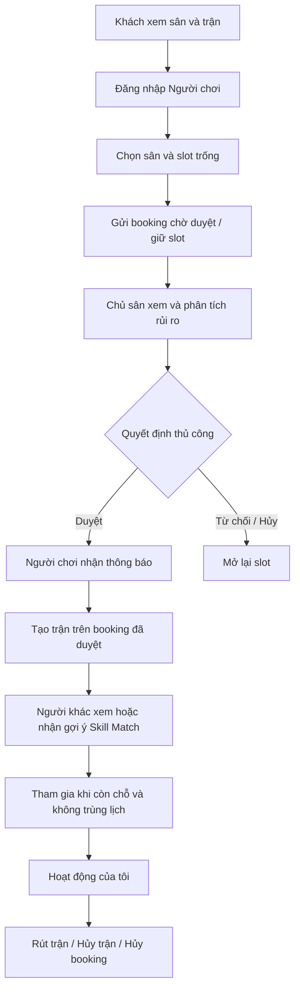

# Luồng nghiệp vụ

## Đặt sân và ghép trận

Hủy riêng trận không tự hủy booking. Hủy booking sẽ hủy trận liên quan. Chủ sân hoàn thành booking sau giờ kết thúc; trận liên quan cũng chuyển hoàn thành. Booking đã hoàn thành được giữ trong lịch sử.

## Điều phối CLB
Sự kiện → danh sách → thêm/bỏ người → đề xuất hai đội → xem giải thích → chuyển người giữa đội → chấp nhận/lưu hoặc từ chối/tạo lại. Danh sách thay đổi sẽ xóa lineup cũ để không lưu người đã bị bỏ khỏi sự kiện. Lưu đội hình kiểm tra không trùng/thiếu người và chênh số lượng tối đa 1.

## Quản trị
Danh mục môn → tạo/sửa/lưu trữ khi không còn ràng buộc. Tài khoản → tạo/sửa/vô hiệu hóa/kích hoạt. Báo cáo → chọn khoảng ngày → lưu snapshot → sửa/tạo lại snapshot → tải CSV hoặc lưu trữ.

## Tài khoản
Đăng ký → gửi mã mô phỏng → nhập OTP → xác minh → đăng nhập. Quên mật khẩu → gửi yêu cầu → OTP → đặt mật khẩu mới → đăng nhập. Mã sai/hết hạn giữ người dùng tại bước kiểm tra và cho gửi lại theo thời gian chờ.

## Sơ đồ trang
- index → tìm sân → chi tiết sân → booking → kết quả → hoạt động cá nhân.
- index → tìm trận → chi tiết trận → hoạt động cá nhân; hoạt động → tạo/sửa trận.
- đăng nhập → trang đầu theo role → menu chức năng và tài khoản.
- hồ sơ, thông báo, cài đặt và trợ giúp dùng chung.
- các màn hình auth là trang riêng theo bản Figma; biến thể lỗi/tải là trạng thái cùng trang.
